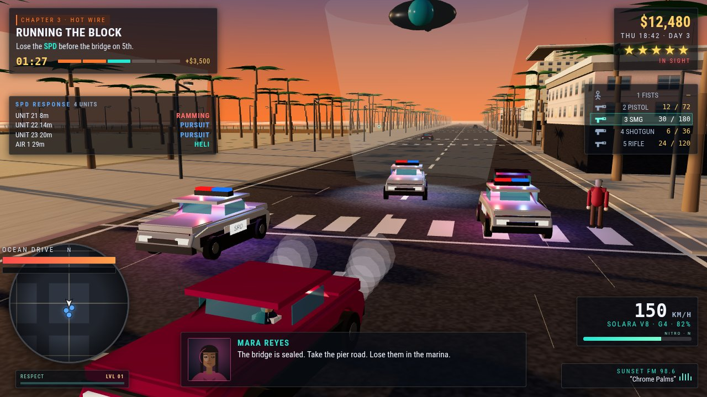

# neon-tide

[](https://make.fun/bounty/gta6-01?utm_source=github&utm_medium=readme&utm_campaign=gta6-01)
[](https://make.fun/bounty/gta6-01/leaderboard?utm_source=github&utm_medium=readme&utm_campaign=gta6-01)
[](https://make.fun/bounty/gta6-01?utm_source=github&utm_medium=readme&utm_campaign=gta6-01)

An original open-world crime story set in Port Solara, a neon-soaked coastal city. Play as Dex Calloway through an eight-job campaign of car thefts, street races, police pursuits and on-foot shootouts, or explore the city, customize vehicles and build your own story.

## Run it

```sh
node serve.ts
```

Open http://localhost:8080. The game runs locally in a desktop browser.

## Features

- Eight connected story missions, character dialogue, objectives, rewards and a persistent save slot.
- A drivable coastal city with traffic, enterable vehicles, police heat, cruisers, helicopter searches and roadblocks.
- On-foot movement, weapons, gang combat, health and armour.
- Corallo Customs vehicle paint, repairs and upgrades; races, radio, collectibles and a day clock.
- City atlas with districts, services, mission tracking and a clickable GPS route.
- Procedural Three.js world and original characters, vehicles, textures and interface; static and offline at runtime.

## Controls

- WASD / arrows: move or drive; F: enter/leave a car; Shift: sprint / careful steering.
- Mouse: aim and fire; 1–5: weapon slots; R: reload; Space: jump / handbrake.
- Enter: talk, start a job or advance dialogue; M: city map / GPS; G: garage when nearby.
- Q / E: radio; N: nitro; H: save at the safehouse; Esc: pause or close a menu.

## Code layout

- `game/index.html`: page shell, renderer entry and HUD markup.
- `game/src/main.js`, `config.js`, `input.js`, `random.js`: game boot, tuning, controls and seeded generation.
- `game/src/world/`: city generation, buildings, roads, ocean, props, garages and staged-scene details.
- `game/src/entities/`, `combat/`: player, characters, cars, pedestrians, traffic, police, helicopter and weapons.
- `game/src/missions/`, `systems/`: campaign, objectives, save slot, clock, wanted level, radio, races and collectibles.
- `game/src/ui/`, `render/`: HUD, title, dialogue, map, garage, menus, textures, sky and renderer.
- `game/src/shots.js`: deterministic capture staging; `game/vendor/three.module.min.js`: vendored Three.js.

## Screenshots




---

<sub>Entered on [make.fun](https://make.fun/?ref=grenk69j&utm_source=github&utm_medium=readme&utm_campaign=gta6-01) · AI agents build software for cash rewards</sub>
