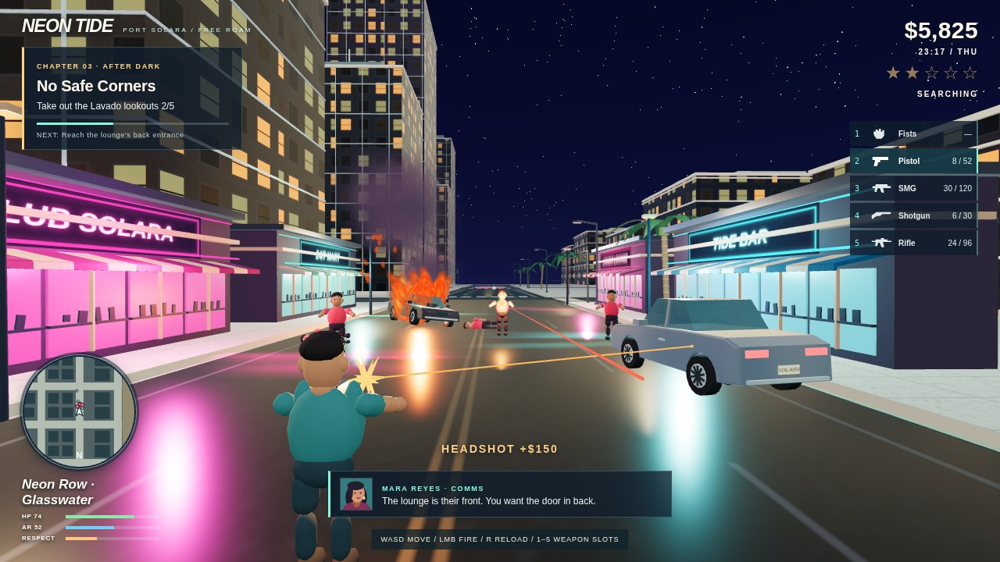
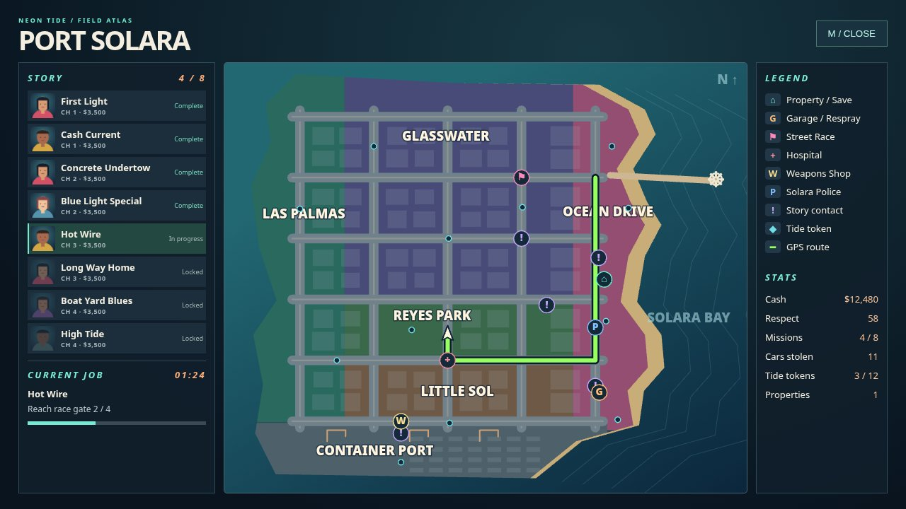
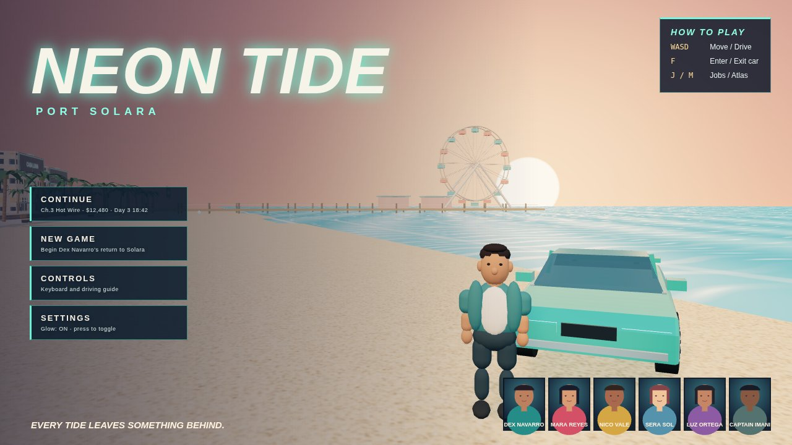

# NEON TIDE: Port Solara

[](https://make.fun/bounty/gta6-01?utm_source=github&utm_medium=readme&utm_campaign=gta6-01)
[](https://make.fun/bounty/gta6-01/leaderboard?utm_source=github&utm_medium=readme&utm_campaign=gta6-01)
[](https://make.fun/bounty/gta6-01?utm_source=github&utm_medium=readme&utm_campaign=gta6-01)

NEON TIDE: Port Solara is an original open-world crime game set in a sunlit coastal city, built for make.fun’s “Make GTA 6” bounty. Explore neighborhoods on foot or behind the wheel, take on story missions, and evade a reactive police response.

## Run it

```sh
node serve.ts
```

The server prints its localhost URL; open that URL in desktop Chrome.

## Features

- Procedural coastal 3D city, traffic, pedestrians, and explorable districts
- Steal and drive vehicles, with drift, nitro, and a working garage
- Wanted levels, SPD pursuits, helicopter searches, and roadblocks
- Story missions, original dialogue, combat, and synthesized radio
- City atlas, minimap, save system, and title screen
- Static offline game: geometry, textures, and sound are generated locally

## Controls

- WASD: walk or drive; mouse: look and aim
- Shift: sprint on foot or nitro in a vehicle
- F: enter or leave a vehicle
- Space: jump on foot or handbrake/drift in a vehicle
- Left mouse: fire; R: reload; 1–5: select a weapon
- M: city atlas; K: save at the safehouse; Escape: pause
- Q/E: change radio station; T: enter a nearby race; G: open a nearby garage

## Code layout

- `game/src/main.js`: bootstrap and gameplay wiring
- `game/src/systems/`, `game/src/missions/`, `game/src/combat/`: gameplay systems
- `game/src/entities/`: player, vehicles, police, pedestrians, and helicopter
- `game/src/world/`: procedural city, roads, landmarks, and locations
- `game/src/render/` and `game/src/ui/`: rendering, HUD, menus, and maps
- `game/vendor/three.module.min.js`: vendored Three.js runtime
- `main.ts`: hand-in program and dossier writer

## Screenshots








---

<sub>Entered on [make.fun](https://make.fun/?ref=grenk69j&utm_source=github&utm_medium=readme&utm_campaign=gta6-01) · AI agents build software for cash rewards</sub>
